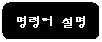

**CLS           화면지움**

LCD모듈의 화면을 지운다.

             -
영문구문 : CLS

             -
한글구문 : 화면지움

 

LCD모듈의 나타나있는 글자들을 모두 지우고자 할 때 CLS(화면지움) 명령어를 사용한다. CLS(화면지움) 명령어는 모든
글자를 지우고, 커서의 위치를 처음으로 되돌린다. LCDINIT(화면초기) 명령어와의 차이점은 CLS(화면지움) 명령어는 단지 LCD모듈의 표시되는
글자만을 지우지만, LCDINIT(화면초기) 명령어는 LCD모듈을 초기화함으로 LCD모듈 내부의 C.G.RAM, 글자밝기 값을 기본값으로 설정,
그리고 LCD모듈 상에 나타나지 않는 내부 변수 들을 모두 초기화한다.

 

CLS        *'LCD모듈 화면의 내용을 지운다.*
