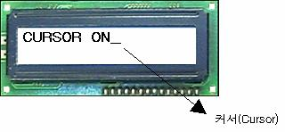

**CSON()      커서보임**

**CSOFF()          커서감춤**

LCD모듈에 커서를 나타내거나/보이지 않게 한다.

             -
영문구문 : CSON   /   CSOFF

             -
한글구문 : 커서보임   /   커서감춤

 

 LCD모듈에 문자열을
출력할 때 커서를 보이거나 감추는 기능을 수행하는 명령어가 CSON(커서보임) 과 CSOFF(커서감춤) 이다. LCD모듈에서 커서의 역할은 현재
문자열을 표시하고자 하는 위치를 가리키며, 일반적인 경우에는 커서를 감추고 사용한다. LCD모듈이 초기화되면 커서는 나타나지 않는 상태가 된다.
이 명령은 화면의 스크롤 기능의 ON/OFF로도 사용된다.

 

LCDINIT

CSON

PRINT
"CURSOR ON"
