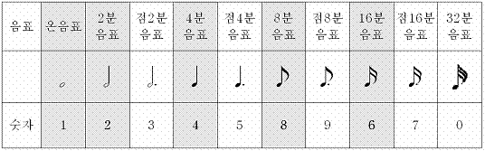

**PLAY         연주**

피에조에
노래를 연주한다. 2000

             -
영문구문 : PLAY "*[연주문자열]*"

             -
한글구문 : 연주 "*[연주문자열]*"

 

로보베이직과 미니로봇 컨트롤러는
음악을 연주할 수 있는 기능을 제공한다. *[연주문자열]*은 연주데이터가 들어가는데, 문자열에 사용할 수
있는 문자와 의미는 다음과 같다.

 

|  |  |  |
| --- | --- | --- |
| **문자열** | | **설   명** |
| **영어/기호** | **한글** |
| C | 도 | 계명 “도” |
| D | 레 | 계명 “레” |
| E | 미 | 계명 “미” |
| F | 파 | 계명 “파” |
| G | 솔 | 계명 “솔” |
| A | 라 | 계명 “라” |
| B | 시 | 계명 “시” |
| T | 템포, 박자, 속도 | 연주 박자(속도)를 조절한다. |
| L | 저 | 저음 옥타브를 선택한다. |
| M | 중 | 중음 옥타브를 선택한다. |
| H | 고 | 고음 옥타브를 선택한다. |
| #, + |  | 반음 올린다.(#) |
| $, - |  | 반음 내린다.(♭) |
| P, ,(쉼표) | 쉼 | 소리를 내지 않고 일정길이만큼 쉰다. |
| < |  | 한 옥타브 내린다. |
| > |  | 한 옥타브 올린다. |

 

 템포(T)는 연주할
때 음의 빠르기를 설정하며, 기본 템포 값은 7이고, 1에서 0까지 설정이 가능하다. 템포 값 0은 10을 의미하며, 가장 느린 빠르기를 갖고,
템포 값 1은 가장 빠른 빠르기를 갖는다.

 MR-C2000 계열
컨트롤러에서 처리할 수 있는 옥타브(Octave)는 3단계이며, 각각 저, 중, 고 옥타브라 불린다.

 음 길이는 0-9까지의
숫자를 사용하며, 숫자의 의미는 다음과 같다.

 

음 길이를 생략하면 바로
그 전의 음 길이로 연주한다. "4CDEF8G" 는 4분 음표 도, 레, 미, 파, 8분 음표의
솔을 연주한다. PLAY(연주) 문이 사용되면 기본적으로 중음 옥타브에, 4분 음표, 계명은 도, 템포 7로 설정되고, 다음 PLAY(연주)에서는
이전의 옥타브와 템포를 이어받는다.

 

① 음의 길이는 음의 앞에 붙인다.   [ 4도  8미  6파   ]

② #이나 플렛은 음의 앞에
붙인다.  [ #도  $미  +파   -솔   4#도 #4도 ]

 

*MR-C3000
계열의 컨트롤러에서는 PLAY(연주) 명령어 대신 MUSIC(음악) 명령어를 사용한다.*

  

 

 

PLAY “M4GGAA GGE GGEED”

PLAY “M4GGAA GGE GEDEC”
