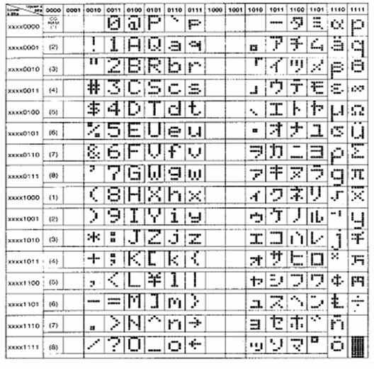

**PRINT  화면출력**

LCD모듈에 글자를 출력한다.

             -
영문구문 : PRINT *“[문자열]” , [숫자]/ “[문자열]”*, ....

             -
한글구문 : 화면출력 *“[문자열]” , [숫자]/ “[문자열]”*, ....

 

PRINT(화면출력)명령어는 LCD모듈의 현재 커서위치에 문자를 출력한다. *[문자열]*은 큰 따옴표 (“)로 구분한다.
*[숫자]*는 1～255사이(0은 사용할 수 없다.) 의 숫자나 상수를 사용할 수 있고, LCD모듈에는 숫자의 아스키 코드(ASCII)에
해당하는 문자가 출력된다. 한글 LCD모듈을 사용할 때는 *[문자열]*에 한글을 사용할 수 있다.

 

 

CLS

PRINT
"miniROBOT ", 126, " LCD"

|  |
| --- |
|  |
|  |  |

 

 

 

 

 

  

 16x2라인 영문
LCD모듈에 아스키 코드로 문자를 출력할 경우에 나타나는 문자들의 집합을 나타내면 다음과 같다.

 각 코드에 해당되는
문자들은 LCD 모듈의 종류에 따라 달라질 수 있다.

 

