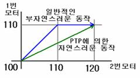

**PTP           점대점**

서보 모터의
동시 동작 제어기능을 ON/OFF 설정한다.

**MR-C2000 계열 컨트롤러)**

             -
영문구문 : PTP *[설정값]*

             -
한글구문 : 점대점 *[설정값]*

 

**MR-C3000 계열 컨트롤러)**

             -
영문구문 : PTP *[SETON/SETOFF/ALLON/ALLOFF]*

             -
한글구문 : 점대점 *[사용설정/사용해제/모두설정/모두해제]*

 

서보모터를 여러 개 동작시킬
경우 움직이는 동작각도가 다를 경우 일정속도에서 모터들의 동작완료 시간이 다르다. 암로봇(Arm Robot)과 같이
여러 모터가 조합되어 움직이는 미니로봇 들의 경우에는 이러한 움직임이 매우 부자연스럽다. 로봇공학(Robot Engineering)에서는 모터들의
종료시점을 계산하여 동시에 동작 완료함으로써 움직임을 자연스럽게 연결하여 주는 점대점(Point to Point) 이론이 존재하는데, 미니로봇컨트롤러에는
점대점 이론의 움직임 제어기법이 내장되어 있다. PTP(점대점) 명령어는 이 움직임 제어기법을 가능하게 한다.

 

 

**MR-C2000 계열 컨트롤러에서의 PTP(점대점) 제어)**

 

 *[설정값]*에는
0(해제) 또는 1(설정)의 숫자 또는 상수를 사용한다. 두 개의 서보모터를 1번 모터, 2번 모터로 사용할 경우, 다음의 프로그램의 예를 보자.

 

- 일반적인 부자연스러운 동작인 경우

 

PTP 0

MOVE 100, 100

MOVE 110, 120

 

설명) 1번 모터는 10도
2번 모터는 20도를 움직이나 같은 속도로 움직이므로 1번과 2번이 10도를 같이 움직이고 2번은 나머지 10도를 혼자서 움직인다.

 

- PTP에 의한 자연스러운 동작인 경우

 

PTP 1

MOVE 100, 100

MOVE 110, 120

 

설명) 1번 모터는 10도
2번 모터는 20도를 움직이나 1번은 2번의 1/2속도로 움직이게되어 있어서 1 ,2번 모터가 동시에 움직여서 1, 2번 모터가 동시에 정지한다.

 

 PTP(점대점) 명령어를
사용한 경우와 사용하지 않는 경우의 모터 움직임에 대한 궤적을 그리면 다음과 같다.

 

즉, 일반적인 동작의 경우에는 모터1과 모터2가 110이라는 각도까지는 동시에 움직이지만, 110 이후에는 모터2만 120각도까지
움직이게 되어 부자연스러운 동작을 하게 된다.

 하지만, PTP에
의한 동작의 경우에는 모터1과 모터2에 대해 움직일 각도 10과 20에 대해 PTP계산을 하고, 계산 값에 의해 동시에 완료하는 자연스러운 동작을
한다.

 

**MR-C3000 계열 컨트롤러에서의 PTP(점대점) 제어)**

 

 MR-C3000의
경우 많은 모터가 사용되므로, 그룹별로 사용되는 MOVE 명령의 경우, 지정된 그룹에서만 PTP 기능을 수행할 것인지, 전체 모든 모터에 대해
PTP 기능을 수행할 것인지를 설정한다.

 

- PTP SETON(점대점 사용설정) : PTP 기능을
그룹별로 설정한다.

- PTP SETOFF(점대점 사용해제) : 그룹별로
설정된 PTP 기능을 해제한다.

- PTP ALLON(점대점 모두설정) : 모든 서보모터의
PTP기능을 설정한다.

- PTP ALLOFF(점대점 모두해제) : 모든 서보모터의
PTP기능을 해제한다.

 

MR-C3000
계열 컨트롤러에서 PTP 기능을 사용하는 경우 각 그룹동작간에 동작완료 지점에 *"WAIT"명령을 사용*하면
확실한 동작완료를 할 수 있다.
