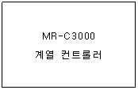
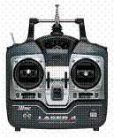
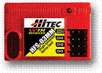

**RCIN()       조종기입력()**

RC용 조종기와 수신기로부터 입력되는 펄스 값을 입력한다. 3000

             -
영문구문 : RCIN (*[RC수신포트]*)

             -
한글구문 : 조종기입력 (*[RC수신포트]*)

 

MR-C3000 계열 컨트롤러의 AD입력 포트에 RC용 조종기와 수신기를 부착하여 조종기의 수신 값을 읽어 들인다. 아래 표는 *[RC수신포트]*의 구성을 보여준다.

 

|  |  |
| --- | --- |
| **MR-C3000 계열 컨트롤러**  **AD 포트 번호 (디지털입출력 포트 번호)** | **RC수신 포트** |
| 0번 포트 (32번 포트) | 0번 RC수신 포트 |
| 1번 포트 (33번 포트) | 1번 RC수신 포트 |
| 2번 포트 (34번 포트) | 2번 RC수신 포트 |
| 3번 포트 (35번 포트) | 3번 RC수신 포트 |
| 4번 포트 (36번 포트) | 4번 RC수신 포트 |
| 5번 포트 (37번 포트) | 5번 RC수신 포트 |
| 6번 포트 (38번 포트) | 6번 RC수신 포트 |
| 7번 포트 (39번 포트) | 7번 RC수신 포트 |

 

 MR-C3000 계열 컨트롤러에 연결하는 RC용 조종기는 AM방식 보다 FM방식을 사용하여야 전파혼선에 의한 오
동작을 방지할 수 있으며, 다양한 기능을 갖는 조종기를 사용하면 로봇 조종을 훨씬 다양한 방법으로 조종할 수 있다.

 

 

 

    
    

 

 

DIM
A AS BYTE

 

   A
= RCIN(0)                               *‘RC수신포트
0번에 연결된 수신기 신호를 A변수에*

*‘저장*
