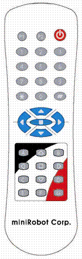

**REMOCON()          리모콘()**

AD변환포트 7번으로부터 적외선 리모콘의 값을 읽어온다. 3000

             -
영문구문 : REMOCON (*[리모콘 종류]*)

             -
한글구문 : 리모콘 (*[리모콘종류]*)

 

MR-C3000 계열 컨트롤러의 AD 변환포트 7번 포트를 이용하여 적외선 리모콘의 눌린 키의 값을 읽어온다. *[리모콘
종류]* 에는 0번부터 정해진 리모콘 종류에 따라 사용하며, 사용할 수 있는 리모콘의 종류는 MR-C3000 계열 컨트롤러의 버전에 따라
추가될 수 있다. 자세한 내용은 뒤 부분의 적외선 리모콘을 사용한 예제를 참조한다.

 

|  |
| --- |
|  |
|  |  |

  
리모콘 종류 0번 (모델명 : MR-IR2)

 

DIM a AS BYTE              *'수신된
값을 받을 변수*

MAIN:                                          *'계속
리모콘의 값을 입력받기 위한 MAIN 라벨*

a = REMOCON(0)                         *'리모콘에서
수신된 값을 a라는 변수에 넣는다.*

ON a GOTO
MAIN,KEY1,KEY2,KEY3,KEY4 *'수신값이 없으면 MAIN으로*

GOTO MAIN                                *'MAIN
라벨로 분기 한다.*

END

KEY1:                                          *'수신된
값이 1이면 처리*

          
...................

GOTO MAIN                               *'수신상태로
가기*

KEY2:                                          *'수신된
값이 2이면 처리*

          
...................

GOTO MAIN                                *'수신상태로
가기*

KEY3:                                          *'수신된
값이 3이면 처리*

          
...................

GOTO MAIN                                *'수신상태로
가기*

KEY4:                                          *'수신된
값이 4이면 처리*

          
...................

GOTO MAIN                                *'수신상태로
가기*

 

  

 

새로 추가된 적외선 리모콘 1번은 기존의 리모콘이 단 1개의 로봇만을 제어할 수 있는 것에 비해, 제어할 수 있는 로봇의 ID 값을 총 4개까지 다르게
설정할 수 있어 여러 대의 로봇을 이용한 로봇 대회, 게임 등이 가능하다. 특히, 이족 보행 로봇 “로보노바(ROBONOVA-I)” 의 제어에
효과적이다.

이족보행 로봇아래 그림과
같은 모양이며, 각 버튼에 대한 코드 값은 다음과 같다.

 

MR-IR3 리모콘 모양

 

 

 

MR-IR3 리모콘 키 코드 표

 

|  |  |  |  |  |  |
| --- | --- | --- | --- | --- | --- |
| **키 번호** | **기능** | **ID에 따른 키 값** | | | |
| **ID-1** | **ID-2** | **ID-3** | **ID-4** |
| K01 | P1 | 25 | 57 | 89 | 121 |
| K02 | P2 | 19 | 51 | 83 | 115 |
| K03 | POWER | 16 | 48 | 80 | 112 |
| K04 | 1 | 1 | 33 | 65 | 97 |
| K05 | 2 | 2 | 34 | 66 | 98 |
| K06 | 3 | 3 | 35 | 67 | 99 |
| K07 | 4 | 4 | 36 | 68 | 100 |
| K08 | 5 | 5 | 37 | 69 | 101 |
| K09 | 6 | 6 | 38 | 70 | 102 |
| K10 | 7 | 7 | 39 | 71 | 103 |
| K11 | 8 | 8 | 40 | 72 | 104 |
| K12 | 9 | 9 | 41 | 73 | 105 |
| K13 | \* | 22 | 54 | 86 | 118 |
| K14 | 0 | 10 | 42 | 74 | 106 |
| K15 | # | 24 | 56 | 88 | 120 |
| K16 | ▲ | 11 | 43 | 75 | 107 |
| K17 | ◀ | 14 | 46 | 78 | 110 |
| K18 | ■ | 26 | 58 | 90 | 122 |
| K19 | ▶ | 13 | 45 | 77 | 109 |
| K20 | ▼ | 12 | 44 | 76 | 108 |
| K21 | A | 15 | 47 | 79 | 111 |
| K22 | △ | 21 | 53 | 85 | 117 |
| K23 | B | 20 | 52 | 84 | 116 |
| K24 | ◁ | 28 | 60 | 92 | 124 |
| K25 | □ | 29 | 61 | 93 | 125 |
| K26 | ▷ | 30 | 62 | 94 | 126 |
| K27 | C | 17 | 49 | 81 | 113 |
| K28 | ▽ | 31 | 63 | 95 | 127 |
| K29 | D | 27 | 59 | 91 | 123 |
| K30 | E | 18 | 50 | 82 | 114 |
| K31 | F | 32 | 64 | 96 | 128 |
| K32 | G | 23 | 55 | 87 | 119 |

 

리모콘 수신 센서의 연결

- 적외선 수신 센서는 MR-C3000, MR-C3024 컨트롤러의 AD7 번 포트에 연결한다.

 

리모콘의 ID 설정방법

- P1 버튼과 변경하고자 하는 ID번호(1, 2, 3, 4 중 하나) 키를 약 2초간 동시에 누른다.

 

로보베이직의 프로그램 예)

 

*'\*\*\*\* MR-IR3
프로그램 예제 \*\*\*\**

DIM IR\_ID\_CODE
AS BYTE

CONST IR\_ID = 1

 

*‘ID 체크하는 부분*

IF IR\_ID = 1
THEN

IR\_ID\_CODE = 0

ELSEIF IR\_ID =
2 THEN

IR\_ID\_CODE = 32

ELSEIF IR\_ID =
3 THEN

IR\_ID\_CODE = 64

ELSEIF IR\_ID =
4 THEN

IR\_ID\_CODE = 96

ENDIF

 

MAIN:

A = REMOCON(1)

A = A - IR\_ID\_CODE

 

             ON
A GOTO MAIN, KEY1, KEY2, KEY3, KEY4,
……

GOTO MAIN

END

 

KEY1:

             ………

             GOTO
MAIN

 

KEY2:

             ………

             GOTO
MAIN

 

KEY3:

             ………

             GOTO
MAIN
