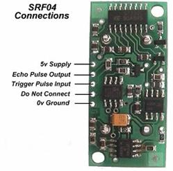

**SONAR()    초음파()**

초음파
포트에 연결된 초음파 센서로부터 계산된 거리를 읽어온다. 3000

             -
영문구문 : SONAR (*[초음파 포트]*)

             -
한글구문 : 초음파 (*[초음파 포트]*)

 

MR-C3000 계열 컨트롤러의 디지털 입출력 포트 0번부터 15번 포트까지를 초음파 포트 0번부터 7번까지로 사용하며, 아래
표와 같이 구성된다.

 

|  |  |
| --- | --- |
| **MR-C3000 계열 컨트롤러**  **디지털 입출력 포트 번호** | **초음파 포트** |
| 0번 포트 | 0번 초음파 포트 출력 |
| 1번 포트 | 0번 초음파 포트 입력 |
| 2번 포트 | 1번 초음파 포트 출력 |
| 3번 포트 | 1번 초음파 포트 입력 |
| 4번 포트 | 2번 초음파 포트 출력 |
| 5번 포트 | 2번 초음파 포트 입력 |
| 6번 포트 | 3번 초음파 포트 출력 |
| 7번 포트 | 3번 초음파 포트 입력 |
| 8번 포트 | 4번 초음파 포트 출력 |
| 9번 포트 | 4번 초음파 포트 입력 |
| 10번 포트 | 5번 초음파 포트 출력 |
| 11번 포트 | 5번 초음파 포트 입력 |
| 12번 포트 | 6번 초음파 포트 출력 |
| 13번 포트 | 6번 초음파 포트 입력 |
| 14번 포트 | 7번 초음파 포트 출력 |
| 15번 포트 | 7번 초음파 포트 입력 |

 

 

 *SONAR의 값을 받는 변수는
반드시* *정**수형**을 사용*한다. 즉, SONAR가 리턴하는 값은
0-3000까지 이며, 0이면 감지가 안 되는 경우, 그 외에는 mm 단위의 감지된 거리이다.

MR-C3000
계열 컨트롤러에서 사용 가능한 초음파센서는 ROBOT ELECTRONICS사의 SRF04모델이다.

 

 

   

 

 

초음파 센서의 연결은 MR-C3000(초음파출력) -> SRF04(Trigger Pulse Input), MR-C3000(초음파입력)
<- SRF04(Echo Pulse Output) 이다.

 

 

DIM A AS
INTEGER                 *'A라는**정**수형* *변수를 선언한다.*

A =
SONAR(3)                        *'초음파
포트 3번(디지털 입출력 포트 6,7번*

*‘포트)를 이용하여 초음파 수신 값(거리)을 A라는*

*‘변수에 저장한다.*
