**로보베이직 설치 및 구성**

 

**1. 로보베이직(ROBOBASIC)의 설치**

 

① “Setup.exe” 파일을 실행한다.

 

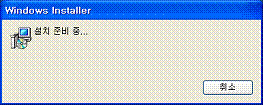

 

 

 현재 설치하는 로보베이직은 버전이 v2.2 이며, 프로그램의 기능 개선을 위해 버전이
다를 수 있다. 로보베이직의 최신 버전은 로보베이직 홈페이지   (htpp://www.robobasic.com)을 통해 제공된다.

 

 

  

② 로보베이직을 설치할 경로(Folder)를 선택하고, <Next>를 누른다.

 

 

③ 로보베이직의 설치가 진행된다.

 

 

④ 로보베이직의 설치가 모두 완료되었다.

 

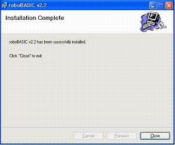

 

**2. 로보베이직(ROBOBASIC)의 초기설정**

 

① 설치된 로보베이직을 처음 실행하면, 초기설정 화면이 나타난다.

 

 

 로보베이직은 여러 종류의 컨트롤러를 지원하기 때문에, 주로 사용하는 컨트롤러를 선택한다.
여기서 로보노바를 사용하기 위해서는 “MR-C3024 직렬(로보노바)”를 선택하고, <다음단계>를 선택한다.

 

② MR-C3024는 컴퓨터의 직렬통신(시리얼)포트를 사용하므로, 사용할 직렬포트를 선택한다.
기본값은 “포트번호 : 1” 이다.

 

 

③ 모든 설정이 완료되면 <완료> 버튼을 누른다.

 

 

  

 

**3. 로보베이직(ROBOBASIC)의 초기 실행**

 로보베이직의 초기설정이 완료되면 로보베이직 프로그램이 실행된다.

 

 로보베이직이 위와 같이 제대로 실행되지 않으면, 다시 설치하기 바란다. 또한, 앞에서
언급한 로보베이직의 권장 사항 이하인 컴퓨터에서 실행할 경우, 정상적으로 동작하지 않을 수 있다.

 

  

 

**4. 로보베이직(ROBOBASIC)의 동작 확인**

로보베이직으로 로보노바에 동작하는 프로그램을 작성하기 위해서는 로보베이직과 로보노바가
서로 연결되어 있어야 한다. 즉, 컴퓨터에 설정한 직렬통신 포트와 로보노바의 MR-C3024 컨트롤러 간에 인터페이스
케이블(모델명: MR-SC15)이 연결되어 있어야 하며, 로보노바에 전원이 켜져 (ON) 있어야 로보베이직으로 작성한 프로그램이
MR-C3024 컨트롤러에 탑재되어 로보노바가 동작하게 되는 것이다.

<MR-SC15>

 

① 컴퓨터의 시리얼 포트와 MR-SC15 케이블의 연결은 다음과 같이 한다.

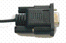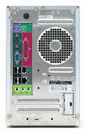

② MR-SC15 케이블의 반대편 연결 잭은 로보노바의 뒤쪽에 MR-C3024 보드에 장착된
인터페이스 연결 단자에 꼽는다.

 

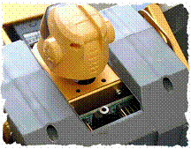

 

③ 로보노바의 전원을 켠다. (Power ON)

 

④ 로보노바와 컴퓨터가 제대로 연결되었으면 먼저 [컨트롤러(C) → 컨트롤러정보] 또는 단축아이콘()를 클릭 한다.

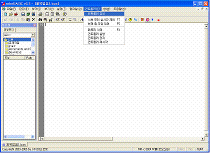

 

 

⑤ 화면에 컨트롤러 정보 창이 나타나고, 각 항목에 맞게 컨트롤러의 정보가 보여진다.

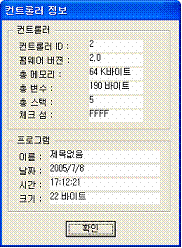

 

 컨트롤러의 펌웨어 버전 및 기타 정보는 은 기능 개선을 위해 달라질 수
있다.

 

 만일 설정이 제대로 되어 있지 않거나, 로보노바의 전원이 켜져 있지 않으면 다음과
같은 에러 메시지 창이 뜨게 된다

 

<컨트롤러 에러 메시지>

 

⑥ 만약, 통신 포트설정을 다시 하고자 한다면,
로보베이직에서 다음과 같이 한다.

 

[설정(T) → 포트설정]을 차례로 클릭 한다.

설치된 포트로 변경한다.

 

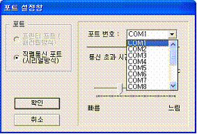

 

**5. 로보베이직(ROBOBASIC)의 화면 구성**

 

로보베이직으로 일반적인 편집기 기능과 베이직 컴파일러가 통합된 통합환경을 제공한다. 로보베이직의 전체 화면 구성은 다음과 같다.

 

 

  

 

**6. 로보베이직(ROBOBASIC)의 메뉴 구성**

 

① 파일(F)

|  |  |
| --- | --- |
| |  | | --- | | 새 프로그램 작성 : 새로운 프로그램을 작성한다.  프로그램 열기 : 기존에 작성된 프로그램을 불러온다.  프로그램 닫기 : 현재 편집 중인 프로그램을 닫는다.  프로그램 저장 : 현재 편집 중인 프로그램을 저장한다.  새 이름으로 저장 : 현재 편집 중인 프로그램을 다른 이름으로 저장한다..  모두 저장하기 : 현재 열려 있는 모든 프로그램을 저장한다.  프로그램 출력 : 현재 편집 중인 프로그램을 프린터로 출력한다.  프린터 설정 : 출력할 프린터를 설정한다.  최근 프로그램 : 최근에 작업한 프로그램을 선택한다.  종료 : 로보베이직 프로그램을 종료한다. | |

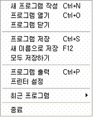

 

② 편집(E)

|  |  |
| --- | --- |
| |  | | --- | | 취소 : 방금 실행한 편집 명령을 취소한다.  재실행 : 이전 취소한 편집 명령을 재실행한다.  잘라내기 : 현재 편집 창에서 선택한 부분을 잘라낸다.  복사 : 현재 편집 창에서 선택한 부분을 복사한다.  붙혀넣기 : 현재 편집 창의 커서 위치에 이전 잘라냈거나 복사한 부분을 붙혀 넣는다.  삭제 : 현재 편집 창에 선택한 부분을 삭제한다.  설명문 영역 설정 : 현재 편집 창에 선택한 부분을 모두 설명문으로 바꾼다.  설명문 영역 해제 : 현재 편집 창에 선택한 부분이 설명문이면 모두 해제한다.  전체 선택 : 현재 편집 창 전체를 선택한다.  라인(줄) 선택 : 현재 편집 창 커서 위치 라인을 선택한다. | |

 

  

 

③ 찾기(S)

|  |  |
| --- | --- |
| |  | | --- | | 찾기 : 원하는 문자열을 찾는다.  다음 찾기 : 찾은 문자열을 다음 부분부터 찾는다.  이전 찾기 : 찾은 문자열을 이전 부분부터 찾는다.  바꾸기 : 원하는 문자열을 찾아 다른 문자열로 바꾼다.  라인(줄) 바로 가기 : 원하는 라인(줄)로 이동한다. | |

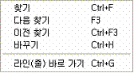

 

④ 보기(V)

|  |  |
| --- | --- |
| |  | | --- | | 메뉴 툴바 보기 : 로보베이직의 메뉴 툴바를 보이거나 감춘다.  다중 편집 탭 보기 : 로보베이직 편집창 하단의 다중 멀티 탭을 보이거나 감춘다.  보조창 보기 : 로보베이직 좌측의 보조창을 보이거나 감춘다.  문법 팁 보기 : 편집 창에 프로그램 작성 시 명령어 입력 후 명령어 문법에 대한 팁을 보이거나 감춘다.  선택 라인(줄) 밝게 : 편집 창에서 선택한 부분을 밝게 표시하거나 표시하지 않는다.  빈 공간 표시 : 프로그램의 빈 공간(공백)을 표시하거나 감춘다.  모든 파일(\*.\*) 목록 표시 : 로보베이직 좌측 보조창의 파일 목록에서 모든 파일(\*.\*)을 보이거나 베이직 파일(\*.bas) 파일만 보이는 것을 선택한다. | |

 

 

 

 

 

⑤ 설정(S)

|  |  |
| --- | --- |
| |  | | --- | | 편집기 설정 : 편집 창의 속성을 설정한다.  포트 설정 : 컨트롤러와 연결되는 컴퓨터의 포트를 설정한다.  컨트롤러 종류 : 연결되어 있는 컨트롤러의 종류를 선택한다.  AI모터 설정창 : AI모터의 속성을 설정한다. | |

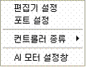

 

  

 

⑥ 컴파일(O)

|  |  |
| --- | --- |
| |  | | --- | | 목적코드 생성 : 작성한 베이직 프로그램을 컴파일하여 컨트롤러에 다운로드할 목적코드를 생성한다.  다운로드 : 생성된 목적코드를 컨트롤러에 전송한다.  통합실행 : 목적코드 생성과 다운로드를 동시에 실행한다.  영점설정 : 컨트롤러에 연결한 서보모터의 영점을 설정한다.  디버그 : 다운로드한 프로그램의 수행을 추적하면서 실행상태를 확인한다. | |

 

 

⑦ 컨트롤러(C)

|  |  |
| --- | --- |
| |  | | --- | | 컨트롤러 정보 : 연결되어 있는 컨트롤러의 정보를 보여준다.  서보모터 실시간 제어 : 컨트롤러를 통해 서보모터를 실시간으로 제어하면서 로봇의 동작 프로그램을 쉽게 한다.  현재 줄 직접 제어 : 현재 편집 창의 커서 위치의 명령을 직접 실행한다.  메모리 삭제 : 연결된 컨트롤러에 탑재된 프로그램을 삭제한다.  컨트롤러 실행 : 연결된 컨트롤러에 탑재된 프로그램을 실행한다.  컨트롤러 정지 : 현재 실행 중인 컨트롤러 프로그램을 정지한다.  컨트롤러 재시작 : 현재 컨트롤러 프로그램을 재시작한다. | |

 

 

 

 

⑧ 창(W)

|  |  |
| --- | --- |
| |  | | --- | | 수평 바둑판식 배열 : | |

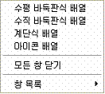

 

 

 

 

 

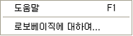

 

 

**1.****로보베이직의
프로그래밍**

 

 로보베이직 설치 및 설정이 끝났다면 프로그래밍 작업을 한다. 새로운 프로그램을 작성하거나
기존에 작성해두었던 파일을 불러온다. 파일은 [\*.bas] 형식으로 저장된다.

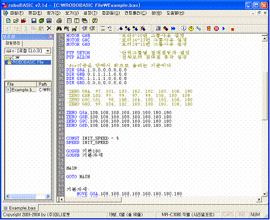

 

 작성한 프로그램을 컨트롤러에 저당시키기 위해서는 먼저 **컴파일(Compile)**과정을
통해 **목적코드**로 만들고 그 후에 **다운로딩** 과정을 통해 컨트롤러의 **롬(ROM)**에 저장시킬 수 있다. 각 과정을
따로 수행해도 되지만 통합실행으로 한 번에 작업을 할 수도 있다.

 

목적코드 생성(F2)  또는  [컴파일(O) → 목적코드
생성(F2)]를 실행

 다운로드(F6) 또는 [파일(O) → 다운로드(F6)]를 실행

              통합실행(F9)  또는 [파일(O)
→ 통합실행(F9)]를 실행

 → 

 

 다음과 같이 코드의 크기가 표시되고 확인을 누르면 다운로딩 창이 뜨면서 컨트롤러에
저장된다.

 

2.      
로보베이직의 서보모터
실시간 제어

로보베이직을 이용해 프로그램을 작성할 때 로봇의 동작을 실시간으로 제어하므로서 프로그램을
빠르고 쉽게 작성할 수 있는 기능이다. 또한 로봇의 완성도를 한층 높일 수 있다.

 

사용될 컨트롤러에 다운로딩 케이블과 전원을 연결하여 스위치를 켠 상태에서 로보베이직을
처음 실행한다.

 서보모터 실시간 제어 아이콘 또는 [컨트롤러(C)
→ 서보모터 실시간제어(F7)]을 클릭하면 서보모터 실시간 제어창이 뜬다.

 

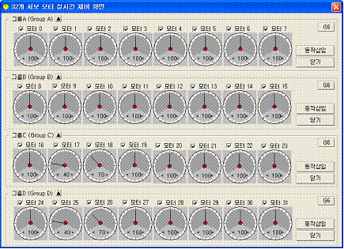

 

        서보모터
실시간제어를 사용할 서보모터를 표시한다.

       서보모터의
위치를 표시한다. 범위는 10~190이다.

                       서보모터
그룹을 열고 닫는다.

 

               서보모터의
그룹을 6개단위로 지정하고 4개 그룹 24개의 다이얼창만을 표시한다.

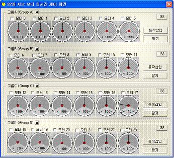

 

     프로그램창 커서위치에
MOVE 명령을 삽입한다.

예] MOVE G8A,100,100,100,100,100,100,100,100

 

     서보모터 실시간 제어창을 닫는다.

3.      
로보베이직의 디버깅

작성한 프로그램을 컨트롤러에서 한 단계씩 실행해가며 확인하는 디버깅 기능이다. 이 기능을 활용하면 프로그램을 오류를 쉽게 찾아 원하는 프로그램을 쉽게 작성하도록 도와준다.

 

사용될 컨트롤러에 다운로딩 케이블과 전원을 연결하여 스위치를 켠 상태에서 컨트롤러에
프로그램을 다운로드 하고 [컴파일(O)
→ 디버깅)]을 클릭한다.

디버깅 창에 표시된 파란 라인은 현재 컨트롤러의 프로그램 실행 위치를 나타내며 한단계
실행 버턴으로 컨트롤러의 프로그램을 진행시킨다.

         프로그램을
한 단계씩 실행한다.

         컨트롤러를
계속 실행한다.

         컨트롤러의
프로그램 메모리를 삭제한다.

         디버깅
창을 닫는다.

 

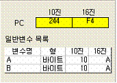         

예]        …

             DIM A AS BYTE

DIM B AS BYTE

…

프로그램에서 선언된 모든 변수의
변수명과 변수형, 그리고 변수값을 10진수와 16진수로 보여준다.
