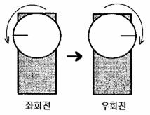

**DIR      방향**

Imposta la direzione di movimento dei servomotori.

**Controller della serie MR-C2000)**

 

             -
Sintassi inglese : DIR *[direzione motore 0], [direzione motore 1], ....., [direzione motore 5]*

             -
Sintassi coreana : 방향 *[direzione motore 0], [direzione motore 1], ....., [direzione motore 5]*

 

**Controller della serie MR-C3000)**

             -
Sintassi inglese : DIR *[gruppo], [direzione motore n], .....*

             -
Sintassi coreana : 방향 *[gruppo], [direzione motore n], .....*

 

Il servomotore, rispetto all'angolo di riferimento 100, ruota a sinistra per angoli minori e a destra per angoli maggiori. La figura seguente mostra un servomotore che, per l'angolo 10, ruota a sinistra con rotazione normale, mentre con rotazione inversa impostata dal comando DIR(방향) ruota a destra per lo stesso angolo 10.

 

 

 

 

 

 

*[direzione motore]* usa un numero o una costante: 0 (rotazione inversa/sinistra) oppure 1 (rotazione normale/destra); il valore predefinito è 1, cioè rotazione normale. Inoltre, come nel comando MOVE(동작), si possono specificare solo i motori che si vogliono usare. Se si usano 4 motori, fino al numero 4, omettendo la direzione del motore 3 come in DIR 0, 1, , 0, viene impostata la rotazione normale predefinita 1.

 

 

**Esempi d'uso nei controller della serie MR-C2000)**

 

DIR 0, 1, 1, 0, 1, 0

DIR , , 0

 

**Esempi d'uso nei controller della serie MR-C3000)**

 

DIR
G8A, 0, 1, 0, 0, 1, 0, 0, 0

      
DIR G8B, 1, 0, 1, 1, 0, 1, 1, 1
