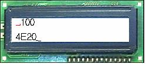

**FORMAT()  형식()**

**DEC()        십진()**

**HEX()        십육진()**

**BIN()         이진()**

Specifica il formato dei numeri da mostrare sul modulo LCD.

 

             -
Sintassi inglese : FORMAT (*[variabile], [formato di uscita], [numero di cifre]*)

             -
Sintassi coreana : 형식 (*[variabile], [formato di uscita], [numero di cifre]*)

 

Per visualizzare una variabile sul modulo LCD, a differenza di una normale stringa, occorre indicarne il formato. Il comando FORMAT deve essere usato sempre dopo il comando PRINT e specifica il formato di uscita della variabile.

 

|  |  |  |
| --- | --- | --- |
| [tipo variabile]/[formato di uscita] | Cifre predefinite | Valori rappresentabili |
| Byte/decimale | 3 | 0 ～ 255 |
| Byte/esadecimale | 2 | 00 ～ FF |
| Byte/binario | 8 | 00000000 ～ 11111111 |
| Intero/decimale | 5 | 0 ～ 65535 |
| Intero/esadecimale | 4 | 0000 ～ FFFF |
| Intero/binario | 16 | 0000000000000000 ～ 1111111111111111 |

 

*[variabile]* può essere una variabile di tipo byte o intero; come *[formato di uscita]* si usano le parole riservate DEC (decimale), HEX (esadecimale) o BIN (binario) per visualizzare il valore della variabile in decimale, esadecimale o binario. *[numero di cifre]* specifica le cifre della variabile in uscita e può essere omesso. Se omesso, il valore predefinito dipende da *[variabile]* e *[formato di uscita]*.

 Se *[numero di cifre]* è maggiore del numero di cifre da visualizzare, l'uscita è allineata a destra e gli spazi vuoti sono riempiti con spazi. Se *[numero di cifre]* è minore del numero di cifre da visualizzare, vengono visualizzate le prime cifre, a partire da sinistra, fino al numero indicato.

 

DIM A AS BYTE

DIM B AS
INTEGER

 

LCDINIT

A = 100

B = 20000

LOCATE 0, 0

PRINT FORMAT(A,
DEC, 4)

LOCATE 0, 1

PRINT FORMAT(B,
HEX)
