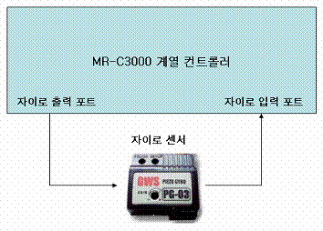

**GYRODIR         Direzione giroscopio**

Imposta la direzione di movimento dei servomotori per l'elaborazione del sensore giroscopico. 3000

             -
Sintassi inglese : GYRODIR *[specifica gruppo], [direzione di movimento motore n],……*

             -
Sintassi coreana : 자이로방향 *[specifica gruppo], [direzione di movimento motore n],……*

Quando si collega un sensore giroscopico alle porte di ingresso AD di un controller serie MR-C3000 e si applica il valore elaborato dal sensore a ciascun servomotore collegato alle porte, si imposta la direzione del movimento elaborato. Si possono collegare al massimo 4 sensori giroscopici (4 porte giroscopio), collegati come segue.

 

|  |  |
| --- | --- |
| **Controller serie MR-C3000**  **Numero porta AD (numero porta I/O digitale)** | **Porta giroscopio** |
| Porta 0 (porta 32) | Porta di uscita canale 1 del giroscopio |
| Porta 1 (porta 33) | Porta di uscita canale 2 del giroscopio |
| Porta 2 (porta 34) | Porta di uscita canale 3 del giroscopio |
| Porta 3 (porta 35) | Porta di uscita canale 4 del giroscopio |
| Porta 4 (porta 36) | Porta di ingresso canale 1 del giroscopio |
| Porta 5 (porta 37) | Porta di ingresso canale 2 del giroscopio |
| Porta 6 (porta 38) | Porta di ingresso canale 3 del giroscopio |
| Porta 7 (porta 39) | Porta di ingresso canale 4 del giroscopio |

 

 Il valore in ingresso del sensore giroscopico varia a destra o a sinistra rispetto al valore di riferimento in base all'angolo di rotazione; quando si applica tale valore al servomotore, il comando GYRODIR determina se il valore del giroscopio vada sommato o sottratto al valore corrente del servomotore.

 *[direzione di movimento motore n]* usa "0" oppure "1": con "1", se il valore in ingresso del giroscopio aumenta, il valore corrente del servomotore aumenta; con "0" diminuisce.

 

             GYRODIR
G6A, 1, 1, 0, 0, 1, 0
