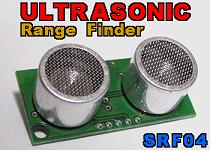

**SONAR()    초음파()**

Legge la distanza calcolata da un sensore a ultrasuoni collegato a una porta a ultrasuoni. 3000

             -
Sintassi inglese : SONAR (*[porta ultrasuoni]*)

             -
Sintassi coreana : 초음파 (*[porta ultrasuoni]*)

 

Le porte I/O digitali da 0 a 15 del controller della serie MR-C3000 vengono usate come porte a ultrasuoni da 0 a 7, con la configurazione mostrata nella tabella seguente.

 

|  |  |
| --- | --- |
| **Controller serie MR-C3000**  **Numero porta I/O digitale** | **Porta ultrasuoni** |
| Porta 0 | Uscita porta ultrasuoni 0 |
| Porta 1 | Ingresso porta ultrasuoni 0 |
| Porta 2 | Uscita porta ultrasuoni 1 |
| Porta 3 | Ingresso porta ultrasuoni 1 |
| Porta 4 | Uscita porta ultrasuoni 2 |
| Porta 5 | Ingresso porta ultrasuoni 2 |
| Porta 6 | Uscita porta ultrasuoni 3 |
| Porta 7 | Ingresso porta ultrasuoni 3 |
| Porta 8 | Uscita porta ultrasuoni 4 |
| Porta 9 | Ingresso porta ultrasuoni 4 |
| Porta 10 | Uscita porta ultrasuoni 5 |
| Porta 11 | Ingresso porta ultrasuoni 5 |
| Porta 12 | Uscita porta ultrasuoni 6 |
| Porta 13 | Ingresso porta ultrasuoni 6 |
| Porta 14 | Uscita porta ultrasuoni 7 |
| Porta 15 | Ingresso porta ultrasuoni 7 |

 

 

 *La variabile che riceve il valore di SONAR deve essere di tipo* *intero*. Il valore restituito da SONAR va da 0 a 3000: 0 indica che non è stato rilevato nulla, altrimenti è la distanza rilevata in mm.

Il sensore a ultrasuoni utilizzabile con i controller della serie MR-C3000 è il modello SRF04 di ROBOT ELECTRONICS.

 

 

   

 

 

Il collegamento del sensore a ultrasuoni è: MR-C3000 (uscita ultrasuoni) -> SRF04 (Trigger Pulse Input), MR-C3000 (ingresso ultrasuoni) <- SRF04 (Echo Pulse Output).

 

 

DIM A AS
INTEGER                 *'Dichiara una variabile intera A.*

A =
SONAR(3)                        *'Usando la porta ultrasuoni 3 (porte I/O digitali 6 e 7)*

*‘salva nella variabile A il valore ricevuto dagli ultrasuoni (la distanza).*
