**Installazione e configurazione di roboBASIC**

 

**1. Installazione di roboBASIC (ROBOBASIC)**

 

① Eseguire il file “Setup.exe”.

 

 

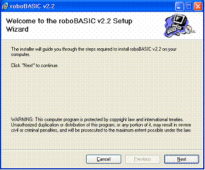

 

 La versione di roboBASIC che si sta installando è la v2.2; la versione può variare a seguito di miglioramenti delle funzionalità del programma. L'ultima versione di roboBASIC è disponibile sul sito di roboBASIC   (htpp://www.robobasic.com).

 

 

  

② Selezionare il percorso (cartella) in cui installare roboBASIC e premere <Next>.

 

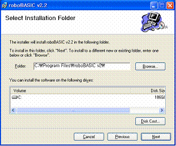

 

③ L'installazione di roboBASIC procede.

 

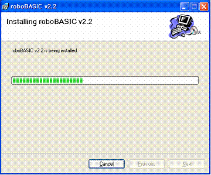

 

④ L'installazione di roboBASIC è completata.

 

 

**2. Configurazione iniziale di roboBASIC (ROBOBASIC)**

 

① Alla prima esecuzione di roboBASIC appena installato compare la schermata di configurazione iniziale.

 

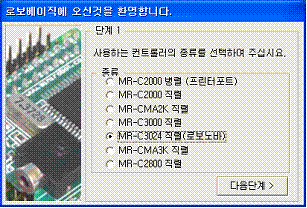

 

 Poiché roboBASIC supporta vari tipi di controller, si seleziona il controller usato più di frequente. Per usare Robonova, selezionare “MR-C3024 seriale (Robonova)” e scegliere <Passo successivo>.

 

② Poiché l'MR-C3024 usa la porta di comunicazione seriale (seriale) del computer, selezionare la porta seriale da usare. Il valore predefinito è “Numero porta : 1”.

 

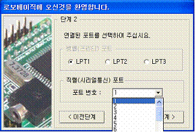

 

③ Una volta completate tutte le impostazioni, premere il pulsante <Fine>.

 

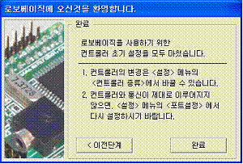

 

  

 

**3. Prima esecuzione di roboBASIC (ROBOBASIC)**

 Terminata la configurazione iniziale di roboBASIC, il programma roboBASIC viene avviato.

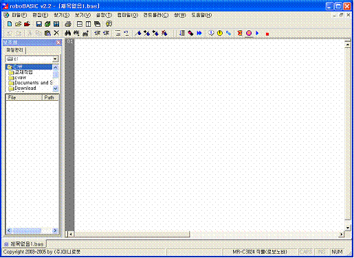

 

 Se roboBASIC non si avvia correttamente come sopra, reinstallarlo. Inoltre, se lo si esegue su un computer che non soddisfa i requisiti consigliati per roboBASIC indicati in precedenza, potrebbe non funzionare correttamente.

 

  

 

**4. Verifica del funzionamento di roboBASIC (ROBOBASIC)**

Per scrivere con roboBASIC programmi che funzionino su Robonova, roboBASIC e Robonova devono essere collegati tra loro. Cioè, tra la porta di comunicazione seriale impostata sul computer e il controller MR-C3024 di Robonova deve essere collegato il cavo di interfaccia (modello: MR-SC15), e Robonova deve essere acceso (ON): solo così il programma scritto con roboBASIC viene caricato sul controller MR-C3024 e Robonova funziona.

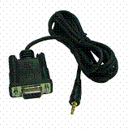

<MR-SC15>

 

① Il collegamento tra la porta seriale del computer e il cavo MR-SC15 si esegue come segue.

② Collegare il jack all'estremità opposta del cavo MR-SC15 al terminale di interfaccia montato sulla scheda MR-C3024, sul retro di Robonova.

 

 

③ Accendere Robonova. (Power ON)

 

④ Se Robonova e il computer sono collegati correttamente, fare prima clic su [Controller(C) → Informazioni controller] oppure sull'icona di scelta rapida ().

 

 

⑤ Sullo schermo compare la finestra delle informazioni del controller, con le informazioni del controller per ciascuna voce.

 

 La versione del firmware del controller e le altre informazioni possono cambiare a seguito di miglioramenti delle funzionalità.

 

 Se le impostazioni non sono corrette o Robonova non è acceso, compare la seguente finestra di messaggio di errore.

 

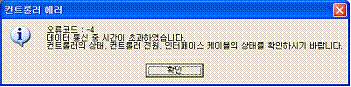

<Messaggio di errore del controller>

 

⑥ Se si vuole impostare di nuovo la porta di comunicazione, in roboBASIC procedere come segue.

 

Fare clic in sequenza su [Impostazioni(T) → Impostazione porta].

Cambiare con la porta installata.

 

 

**5. Struttura della schermata di roboBASIC (ROBOBASIC)**

 

roboBASIC offre un ambiente integrato che combina le funzioni di un normale editor e un compilatore BASIC. La struttura complessiva della schermata di roboBASIC è la seguente.

 

 

  

 

**6. Struttura dei menu di roboBASIC (ROBOBASIC)**

 

① File(F)

|  |  |
| --- | --- |
| |  | | --- | | Nuovo programma : crea un nuovo programma.  Apri programma : carica un programma scritto in precedenza.  Chiudi programma : chiude il programma attualmente in modifica.  Salva programma : salva il programma attualmente in modifica.  Salva con nome : salva il programma attualmente in modifica con un altro nome.  Salva tutto : salva tutti i programmi attualmente aperti.  Stampa programma : stampa il programma attualmente in modifica con la stampante.  Imposta stampante : imposta la stampante da usare.  Programmi recenti : seleziona un programma su cui si è lavorato di recente.  Esci : chiude il programma roboBASIC. | |

 

② Modifica(E)

|  |  |
| --- | --- |
| |  | | --- | | Annulla : annulla il comando di modifica appena eseguito.  Ripeti : ripete il comando di modifica annullato in precedenza.  Taglia : taglia la parte selezionata nella finestra di modifica corrente.  Copia : copia la parte selezionata nella finestra di modifica corrente.  Incolla : incolla, nella posizione del cursore della finestra di modifica corrente, la parte tagliata o copiata in precedenza.  Elimina : elimina la parte selezionata nella finestra di modifica corrente.  Imposta area commento : trasforma in commento tutta la parte selezionata nella finestra di modifica corrente.  Rimuovi area commento : se la parte selezionata nella finestra di modifica corrente è un commento, la ripristina.  Seleziona tutto : seleziona l'intera finestra di modifica corrente.  Seleziona riga : seleziona la riga in cui si trova il cursore nella finestra di modifica corrente. | |

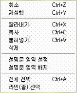

 

  

 

③ Trova(S)

|  |  |
| --- | --- |
| |  | | --- | | Trova : cerca la stringa desiderata.  Trova successivo : cerca la stringa trovata a partire dalla parte successiva.  Trova precedente : cerca la stringa trovata a partire dalla parte precedente.  Sostituisci : cerca la stringa desiderata e la sostituisce con un'altra stringa.  Vai alla riga : si sposta alla riga desiderata. | |

 

④ Visualizza(V)

|  |  |
| --- | --- |
| |  | | --- | | Mostra barra degli strumenti : mostra o nasconde la barra dei menu di roboBASIC.  Mostra schede multiple di modifica : mostra o nasconde le schede multiple nella parte inferiore della finestra di modifica di roboBASIC.  Mostra finestra ausiliaria : mostra o nasconde la finestra ausiliaria a sinistra di roboBASIC.  Mostra suggerimenti di sintassi : mostra o nasconde, durante la scrittura del programma nella finestra di modifica, i suggerimenti sulla sintassi del comando dopo averlo digitato.  Evidenzia riga selezionata : evidenzia o meno la parte selezionata nella finestra di modifica.  Mostra spazi vuoti : mostra o nasconde gli spazi vuoti (spazi) del programma.  Mostra elenco di tutti i file (\*.\*) : sceglie se l'elenco file della finestra ausiliaria a sinistra di roboBASIC mostri tutti i file (\*.\*) o solo i file BASIC (\*.bas). | |

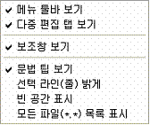

 

 

 

 

 

⑤ Impostazioni(S)

|  |  |
| --- | --- |
| |  | | --- | | Impostazioni editor : imposta le proprietà della finestra di modifica.  Impostazione porta : imposta la porta del computer collegata al controller.  Tipo di controller : seleziona il tipo di controller collegato.  Finestra impostazioni motore AI : imposta le proprietà del motore AI. | |

 

  

 

⑥ Compila(O)

|  |  |
| --- | --- |
| |  | | --- | | Genera codice oggetto : compila il programma BASIC scritto e genera il codice oggetto da scaricare sul controller.  Download : trasmette al controller il codice oggetto generato.  Esecuzione integrata : esegue contemporaneamente la generazione del codice oggetto e il download.  Impostazione punto zero : imposta il punto zero dei servomotori collegati al controller.  Debug : traccia l'esecuzione del programma scaricato per verificarne lo stato di esecuzione. | |

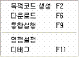

 

 

⑦ Controller(C)

|  |  |
| --- | --- |
| |  | | --- | | Informazioni controller : mostra le informazioni del controller collegato.  Controllo in tempo reale dei servomotori : controlla in tempo reale i servomotori tramite il controller, facilitando la programmazione dei movimenti del robot.  Controllo diretto della riga corrente : esegue direttamente il comando nella posizione del cursore della finestra di modifica corrente.  Cancella memoria : elimina il programma caricato sul controller collegato.  Esegui controller : esegue il programma caricato sul controller collegato.  Ferma controller : ferma il programma del controller attualmente in esecuzione.  Riavvia controller : riavvia il programma corrente del controller. | |

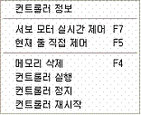

 

 

 

 

⑧ Finestra(W)

|  |  |
| --- | --- |
| |  | | --- | | Affianca orizzontalmente : | |

 

 

 

 

 

 

 

**1.****Programmazione con roboBASIC**

 

 Terminate l'installazione e la configurazione di roboBASIC, si passa alla programmazione. Si crea un nuovo programma oppure si carica un file scritto in precedenza. I file vengono salvati nel formato [\*.bas].

 

 Per salvare il programma scritto sul controller, occorre prima trasformarlo in **codice oggetto** tramite il processo di **compilazione (Compile)** e poi memorizzarlo nella **ROM** del controller tramite il processo di **download**. Si possono eseguire i due passaggi separatamente oppure in un'unica operazione con l'esecuzione integrata.

 

Eseguire Genera codice oggetto (F2)  oppure  [Compila(O) → Genera codice oggetto (F2)]

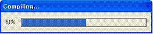

 Eseguire Download (F6) oppure [File(O) → Download (F6)]

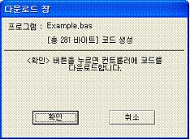

              Eseguire Esecuzione integrata (F9)  oppure [File(O)
→ Esecuzione integrata (F9)]

 → 

 

 Viene mostrata la dimensione del codice come segue; premendo OK compare la finestra di download e il codice viene salvato sul controller.

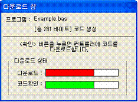

 

2.      
Controllo in tempo reale dei servomotori con roboBASIC

Mentre si scrive un programma con roboBASIC, questa funzione permette di scrivere il programma in modo rapido e semplice controllando in tempo reale i movimenti del robot. Consente inoltre di aumentare ulteriormente il grado di rifinitura del robot.

 

Collegare il cavo di download e l'alimentazione al controller da usare e, con l'interruttore acceso, eseguire roboBASIC per la prima volta.

 Facendo clic sull'icona di controllo in tempo reale dei servomotori oppure su [Controller(C)
→ Controllo in tempo reale dei servomotori (F7)] compare la finestra di controllo in tempo reale dei servomotori.

 

 

        Indica i servomotori da usare per il controllo in tempo reale.

       Indica la posizione del servomotore. L'intervallo è 10~190.

                       Apre e chiude il gruppo di servomotori.

 

               Specifica i gruppi di servomotori a blocchi di 6 e mostra solo 4 gruppi, cioè 24 finestre a quadrante.

 

     Inserisce un comando MOVE nella posizione del cursore della finestra del programma.

Es.] MOVE G8A,100,100,100,100,100,100,100,100

 

     Chiude la finestra di controllo in tempo reale dei servomotori.

3.      
Debug con roboBASIC

È la funzione di debug che permette di eseguire il programma scritto passo per passo sul controller per verificarlo. Utilizzando questa funzione è facile individuare gli errori del programma, il che aiuta a scrivere facilmente il programma desiderato.

 

Collegare il cavo di download e l'alimentazione al controller da usare e, con l'interruttore acceso, scaricare il programma sul controller e fare clic su [Compila(O)
→ Debug)].

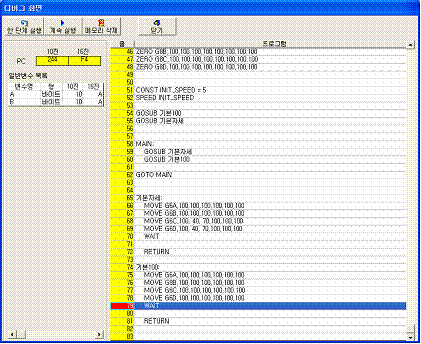

La riga blu mostrata nella finestra di debug indica la posizione corrente di esecuzione del programma del controller; con il pulsante di esecuzione di un passo si fa avanzare il programma del controller.

         Esegue il programma un passo alla volta.

         Continua l'esecuzione del controller.

         Cancella la memoria del programma del controller.

         Chiude la finestra di debug.

 

         

Es.]        …

             DIM A AS BYTE

DIM B AS BYTE

…

Mostra il nome, il tipo e il valore, in decimale ed esadecimale, di tutte le variabili dichiarate nel programma.
